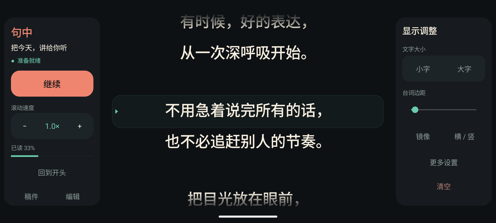
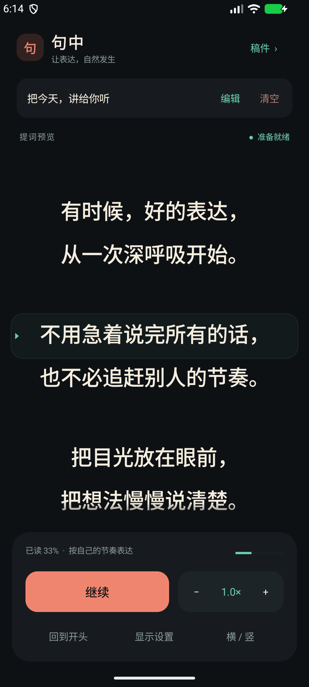

# 句中 · Juzhong

让表达，自然发生。

一个面向老师录微课、教学视频和日常口播的 Android 提词器。横屏采用固定三栏布局：**左侧控制播放，中央显示台词，右侧调整显示**，帮助讲述者把视线集中在中间。

## 下载与安装

从 [GitHub Releases](https://github.com/tonywindy/juzhong/releases) 下载 APK，在 Android 手机上安装。当前版本为 **1.3**，支持 **Android 7.0 及以上**。

当前发布包为调试签名版本，适合直接试用。自行构建时如果签名不同，无法覆盖安装已有版本；更换安装前请先复制备份重要稿件。

## 界面

### 横屏：台词始终位于中央



播放时保留左右控制栏，中央台词区域的位置和宽度保持稳定。

### 竖屏



截图使用示例稿件。

## 功能

- **中央提词**：横屏三栏布局，居中排版，柔和阅读带与位置标记。
- **播放控制**：开始、暂停、继续、回到开头，触摸正文即可暂停。
- **滚动速度**：0.2× 至 2.0×，根据自己的讲课节奏调整。
- **显示调整**：字号、左右边距、文字镜像、横竖屏切换。
- **录制准备**：可关闭的三秒倒计时，播放期间屏幕常亮。
- **稿件管理**：多篇稿件、标题编辑、自动保存、恢复阅读位置。
- **清空与恢复**：一键清空当前稿件，可撤销最近一次清空；撤销期间已有新内容时，会先另存新内容。
- **中断处理**：切到后台自动暂停；读到末尾自动停止。

## 使用方式

1. 点击「稿件」选择或新建一篇讲稿，通过「编辑」输入或粘贴内容。
2. 将手机放在靠近镜头的位置，切换横屏，调整字号、边距和速度。
3. 点击「开始」，倒计时后开始滚动。需要停顿时，点击暂停或轻触正文。

稿件和设置保存在应用本地，无需注册账号。当前应用不申请联网权限，不包含摄像或录音功能；录课时请配合自己的录制设备使用。Android 系统备份由系统设置决定（应用当前允许系统备份）。

## 从源码构建

项目使用原生 Java 和 Android 平台组件，没有第三方运行时依赖。

所需环境：

- JDK 17
- Android SDK，安装 Android API 36 平台及相应构建工具
- Gradle Wrapper 8.13（已包含）
- Android Gradle Plugin 8.13.2

用 Android Studio 打开仓库根目录，同步后运行 `app`。也可以在配置好 Android SDK 的终端中构建：

```sh
./gradlew assembleDebug
```

Windows：

```powershell
.\gradlew.bat assembleDebug
```

Android Studio 会生成本机 `local.properties`，也可以通过 `ANDROID_HOME` 指定 SDK 路径。本机 SDK 路径、缓存和签名文件不提交到仓库。

构建输出：`app/build/outputs/apk/debug/app-debug.apk`。

## 检查与回归验证

```sh
./gradlew lintDebug assembleDebugAndroidTest
```

项目包含自定义模拟器回归入口，覆盖清空撤销、滚动、后台暂停、倒计时、阅读位置与设置恢复、横屏居中、播放时三栏稳定和末尾停止。测试会暂存并恢复模拟器中的原有偏好设置，仍建议使用专用模拟器运行。

```sh
adb install -r app/build/outputs/apk/debug/app-debug.apk
adb install -r app/build/outputs/apk/androidTest/debug/app-debug-androidTest.apk
adb shell am instrument -w com.example.teleprompter.test/com.example.teleprompter.SmokeInstrumentation
```

成功时输出 `PASS: 24 regression assertions`。验证过的环境为本地 Android 模拟器；不同实体设备的表现欢迎通过 Issue 反馈。

## 项目结构

```text
app/src/main/java/.../MainActivity.java     界面、稿件管理与提词逻辑
app/src/main/res/                          应用主题和图标
app/src/androidTest/java/.../              模拟器回归与截图入口
gradle/wrapper/                           Gradle 构建入口
docs/screenshots/                         实际运行截图
```

## 参与与许可

欢迎通过 Issue 提交问题或建议，也欢迎提交 Pull Request。界面修改请保留横屏的核心原则：**台词位于中央，状态与操作位于两侧，播放时文字区域保持稳定**。

本项目以 [MIT License](LICENSE) 开源，允许使用、修改和再分发，请保留许可声明。仓库内 Gradle Wrapper 文件保留其原有许可与版权声明。
